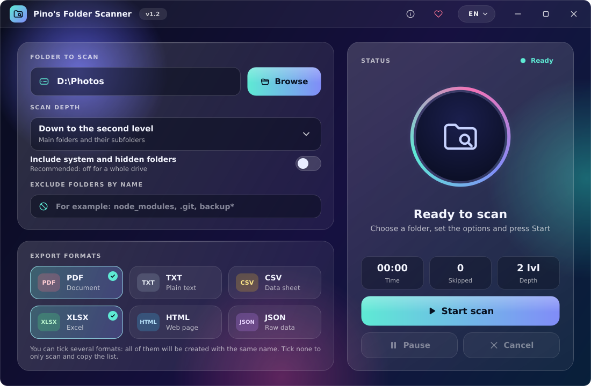
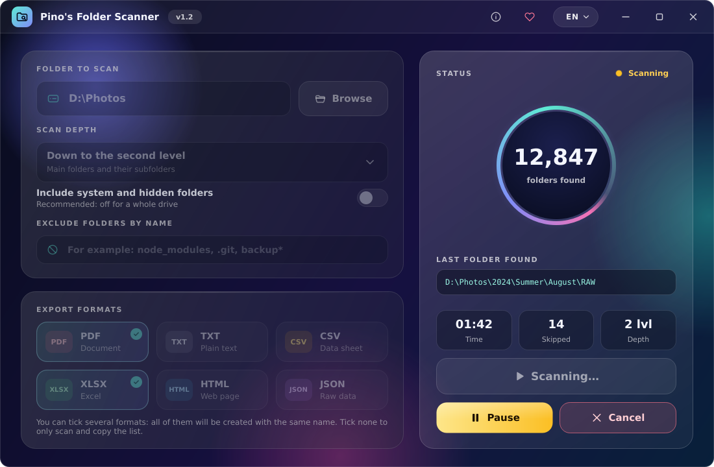

# Pino's Folder Scanner

[](../../releases/latest)
[](../../releases)
[](../../actions/workflows/build.yml)
[](LICENSE)


[](https://ko-fi.com/thenormal)

A small Windows desktop app that scans a drive or a folder and exports the list of its subfolders to **PDF, TXT, CSV, XLSX, HTML or JSON**.

Pick a folder, choose how deep to look, tick the formats you want (or none, to only copy the list), press **Start scan**. That's it.

[](https://ko-fi.com/thenormal)





## Features

- **Any drive or folder**: use *Browse* or paste a path (`D:\`, `D:\Photos`, a network path…).
- **Descriptive depth**: selected folder only, first level only, down to the second or third level, or all subfolders.
- **System and hidden folders** are left out by default (`$Recycle.Bin`, `System Volume Information`, `Windows`, `Program Files`… in the root of a drive, plus anything with the hidden/system attribute). One switch includes them.
- **Six export formats**, tick as many as you like: they are all created with the same file name. You choose where to save every time. Tick none to only scan: no "Save as" window and no file.
- **Exclude folders by name** (for example `node_modules, .git, backup*`): upper and lower case do not matter, `*` and `?` work as wildcards. A folder left out is not opened, so the scan is faster, and nothing inside it is listed.
- **Pause, Resume and Cancel** while scanning, with a live counter and the last folder found. Cancelling creates no files.
- **Folders that cannot be read** (no permission, removed while scanning…) are skipped without stopping the scan, and listed in a "not scanned" section of the report.
- **Symbolic links and junctions are not followed**, so there are no endless loops.
- Long paths (over 260 characters) and Unicode names (accents, Cyrillic, Japanese…) are handled.
- **Drag and drop**: drag a folder or a drive onto the window to choose it (a file stands for the folder that contains it).
- **Copy list**: when a scan is complete, one button copies the full paths, one per line, to the clipboard.
- **Eight languages**: English, Italian, German, Spanish, French, Dutch, Portuguese and Chinese (Simplified), chosen from a drop-down menu in the title bar. The interface and the exported files follow it, and the language of Windows is used on the first start. The translations other than English and Italian have not been checked by native speakers yet: corrections are welcome (see Contributing).
- **Diagnostic report** to help with problem reports (see below). Nothing is ever sent by the program.
- Remembers your last settings.
- Glass-style interface with animations.

## Download

Get `Pinos_Folder_Scanner.exe` from the [Releases](../../releases) page. It is a single file: no installation, just double-click it. The first start takes a few seconds because the file unpacks itself.

> **Windows SmartScreen / antivirus warning.** The executable is not code-signed, and single-file programs built with PyInstaller are sometimes flagged by mistake. If Windows shows a warning, click *More info* → *Run anyway*, or add the file to your antivirus exclusions. If you prefer not to trust a binary, build it yourself from this source (see below): it takes a couple of minutes.

Every release also has a `Pinos_Folder_Scanner.exe.sha256` file. The executable is built automatically on GitHub from the public source, so you can compare the checksum of your download with that file.

Developed for **Windows 11**; Windows 10 is expected to work too.

## How to use

1. Press **Browse** (or type a path, or drag a folder onto the window) and choose a drive or folder.
2. Choose the **scan depth** from the menu.
3. Leave *Include system and hidden folders* off (recommended for a whole drive), or turn it on.
4. Optional: write the names of folders to leave out in **Exclude folders by name**, separated by commas (for example `node_modules, .git`).
5. Tick one or more **export formats**, or none to only scan.
6. Press **Start scan** and choose where to save (with no format ticked there is nothing to save). If a file already exists you are asked before it is replaced.
7. Use **Pause / Resume** and **Cancel** while it runs.
8. When it finishes, a message tells you how many folders were found and which files were created. Nothing is opened automatically. The **Copy list** button copies the list to the clipboard.

### What the output looks like

- The list contains **full paths** in **alphabetical order**, e.g. `D:\Photos\2024\Summer`. Names only: no sizes or dates.
- With *Selected folder only*, the list contains just the chosen folder. With the other depths it contains its subfolders, and the starting folder is named in the report header.
- **PDF**: header with the scanned path, date and time, depth, totals and scan duration; page numbers in the footer; the "not scanned" list at the end. The PDF uses Windows fonts for non-Latin names; emoji and rare symbols may show as empty boxes in the PDF (the other formats have no such limit).
- **TXT**, **HTML** (searchable page), **XLSX** (folders, summary and not-scanned sheets), **CSV** (comma-separated, UTF-8 with BOM so Excel reads accents correctly; a second file `..._not_scanned.csv` is created only when some folders were skipped) and **JSON** (summary plus `folders` and `not_scanned` arrays).

### Where things are stored

- Settings: Windows registry, `HKEY_CURRENT_USER\Software\thenormal\PinosFolderScanner`.
- If the program meets an unexpected error it writes the details to `%LOCALAPPDATA%\PinosFolderScanner\errors.log`.

### Diagnostic report and privacy

If something does not work, press the **i** button next to the heart and choose **Save diagnostic report**: it saves a text file wherever you choose, and you can read it before you send it to anyone. **Report a problem** opens the GitHub page for a new issue with the program version and Windows already filled in. At the end of a scan the program offers the report by itself, but only when something really went wrong (a file could not be created, the scan failed or folders were skipped because of an unexpected error). "Access denied" and "not found" are normal and do not trigger it.

The report is always in English and contains:

- the program version, Windows, Python and Qt versions, the interface language and the screen scale;
- the options and results of the last scan: folders found, folders skipped (by reason), scan time, time in pause, folders per second, and the five slowest folders to read;
- the kind of path scanned (local, network or removable drive), how many folders were left out by name and how many were copied to the clipboard;
- time and size of each exported file, and the fonts used in the PDF;
- the last lines of `errors.log`.

**Privacy:** every folder name in the report is replaced by a code (for example `D:\Photos` becomes `<drive>\f_3a9c1e`) that changes in every report and cannot be turned back into the name. The names you type in the exclusion field are never written in it. There is no user name and no computer name, and there is no option to show the real names. The program never sends the report anywhere: you decide whether to share it. The tests check that no real name appears in it.

## Build from source

You need **Python 3.12 or newer** (tick *Add python.exe to PATH* when installing it).

**Build the .exe** – double-click `build_exe.bat`. The first run downloads the packages (internet needed). When it finishes, `dist\Pinos_Folder_Scanner.exe` is ready.

**Run without building** – double-click `run_from_source.bat`, or:

```bat
python -m venv .venv
.venv\Scripts\python -m pip install -r requirements.txt
.venv\Scripts\python main.py
```

## Project layout

| Path | What it does |
| --- | --- |
| `main.py` | Program entry point and unexpected-error handling |
| `app/scanner.py` | Scan engine: depth, filters, links, pause/cancel (no Qt needed) |
| `app/worker.py` | Runs the scan and the export in a background thread |
| `app/exporters.py` | One function per format (PDF, TXT, CSV, XLSX, HTML, JSON) |
| `app/i18n.py` | All the texts of the program in the eight languages (a new language is one more block) |
| `app/diagnostics.py` | The diagnostic report and the masking of folder names (no Qt needed) |
| `app/settings.py` | Settings remembered between runs |
| `app/links.py` | The web links of the program (Ko-fi, GitHub, new issue), opened only when you click them |
| `app/window.py` | Main window, ties everything together |
| `app/widgets.py` | The look: colours, glass cards, buttons, animated ring, icons |
| `app/dialogs.py` | Message boxes in the same style |
| `app/icon.py` | The program icon, drawn in code |
| `assets/icon.ico` | Icon of the .exe (regenerate with `tools/make_icon.py`) |
| `tools/render_states.py` | Saves images of the window in each state (used for the screenshots) |
| `tests/` | Automated tests |
| `.github/workflows/build.yml` | Runs the tests and builds the `.exe` on GitHub; attaches it to each release |
| `ROADMAP.md`, `CHANGELOG.md` | What is planned and what changed in each version |

Some easy changes:

- **Add an export format**: write one function in `app/exporters.py`, register it in `EXPORTERS` and `FORMATS`, and add its label to `app/i18n.py`.
- **Add a language**: copy the `"en"` block in `app/i18n.py`, translate it, add the code to `LANGUAGES` and its own name to `LANGUAGE_NAMES`, and add it to `UNVERIFIED_LANGUAGES` until a native speaker has checked it; the language menu in the title bar lists it by itself. `tests/test_core.py` checks that every text and every `{placeholder}` is there.
- **Change the colours**: the constants at the top of `app/widgets.py` and the background in `app/window.py`.

### Tests

```bat
python tests\test_core.py
python tests\test_diagnostics.py
python tests\test_gui.py
```

The first one tests the texts of all the languages, scanning (depth, filters, exclusion by name, links, permissions, pause/cancel) and all the exports; the second one tests the diagnostic report, above all that no real folder name can appear in it; the third drives the window without showing it (start, pause, cancel, language menu, drag and drop, info window, Copy list…). They need no screen and write nothing outside a temporary folder. For one check of the Chinese PDF the first test also uses `pypdf`, a tool used only by the tests (`pip install -r requirements-dev.txt`); without it that check is skipped.

## Roadmap

See [ROADMAP.md](ROADMAP.md) for the ideas that may come next (a light theme, code signing of the `.exe`, more languages on request). The changes of each version are in [CHANGELOG.md](CHANGELOG.md).

## Contributing

Bug reports, ideas and translation fixes are welcome: please open an [issue](../../issues) and pick the matching form. For a bug, the easiest way is the **Report a problem** button of the program, with the diagnostic report attached. If a text in your language is wrong or sounds unnatural, use the **Fix a translation** form.

## Support

The program is free and nothing is locked. If you find it useful, you can [support it on Ko-fi](https://ko-fi.com/thenormal) (or with the heart button in the title bar). Thank you!

## Third-party software

- [PySide6 / Qt for Python](https://doc.qt.io/qtforpython-6/) – LGPLv3. The executable bundles the Qt libraries; this repository contains everything needed to rebuild it with your own copy of PySide6.
- [ReportLab](https://www.reportlab.com/opensource/) – BSD license (PDF export).
- [openpyxl](https://openpyxl.readthedocs.io/) – MIT license (XLSX export).
- [PyInstaller](https://pyinstaller.org/) – used to build the single-file executable.

## License

[MIT](LICENSE) © 2026 thenormal
