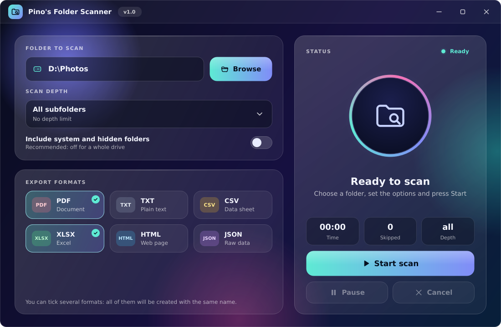
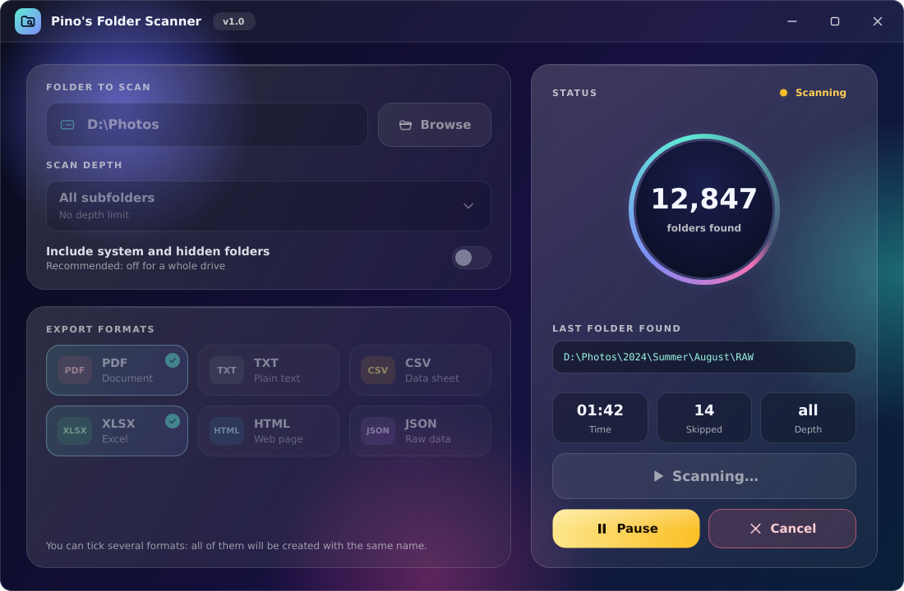

# Pino's Folder Scanner

A small Windows desktop app that scans a drive or a folder and exports the list of its subfolders to **PDF, TXT, CSV, XLSX, HTML or JSON**.

Pick a folder, choose how deep to look, tick the formats you want, press **Start scan**. That's it.





## Features

- **Any drive or folder**: use *Browse* or paste a path (`D:\`, `D:\Photos`, a network path…).
- **Descriptive depth**: selected folder only, first level only, down to the second or third level, or all subfolders.
- **System and hidden folders** are left out by default (`$Recycle.Bin`, `System Volume Information`, `Windows`, `Program Files`… in the root of a drive, plus anything with the hidden/system attribute). One switch includes them.
- **Six export formats**, tick as many as you like: they are all created with the same file name. You choose where to save every time.
- **Pause, Resume and Cancel** while scanning, with a live counter and the last folder found. Cancelling creates no files.
- **Folders that cannot be read** (no permission, removed while scanning…) are skipped without stopping the scan, and listed in a "not scanned" section of the report.
- **Symbolic links and junctions are not followed**, so there are no endless loops.
- Long paths (over 260 characters) and Unicode names (accents, Cyrillic, Japanese…) are handled.
- Remembers your last settings.
- Glass-style interface with animations.

## Download

Get `Pinos_Folder_Scanner.exe` from the [Releases](../../releases) page. It is a single file: no installation, just double-click it. The first start takes a few seconds because the file unpacks itself.

> **Windows SmartScreen / antivirus warning.** The executable is not code-signed, and single-file programs built with PyInstaller are sometimes flagged by mistake. If Windows shows a warning, click *More info* → *Run anyway*, or add the file to your antivirus exclusions. If you prefer not to trust a binary, build it yourself from this source (see below): it takes a couple of minutes.

Developed for **Windows 11**; Windows 10 is expected to work too.

## How to use

1. Press **Browse** (or type a path) and choose a drive or folder.
2. Choose the **scan depth** from the menu.
3. Leave *Include system and hidden folders* off (recommended for a whole drive), or turn it on.
4. Tick one or more **export formats**.
5. Press **Start scan** and choose where to save. If a file already exists you are asked before it is replaced.
6. Use **Pause / Resume** and **Cancel** while it runs.
7. When it finishes, a message tells you how many folders were found and which files were created. Nothing is opened automatically.

### What the output looks like

- The list contains **full paths** in **alphabetical order**, e.g. `D:\Photos\2024\Summer`. Names only: no sizes or dates.
- With *Selected folder only*, the list contains just the chosen folder. With the other depths it contains its subfolders, and the starting folder is named in the report header.
- **PDF**: header with the scanned path, date and time, depth, totals and scan duration; page numbers in the footer; the "not scanned" list at the end. The PDF uses Windows fonts for non-Latin names; emoji and rare symbols may show as empty boxes in the PDF (the other formats have no such limit).
- **TXT**, **HTML** (searchable page), **XLSX** (folders, summary and not-scanned sheets), **CSV** (comma-separated, UTF-8 with BOM so Excel reads accents correctly; a second file `..._not_scanned.csv` is created only when some folders were skipped) and **JSON** (summary plus `folders` and `not_scanned` arrays).

### Where things are stored

- Settings: Windows registry, `HKEY_CURRENT_USER\Software\thenormal\PinosFolderScanner`.
- If the program meets an unexpected error it writes the details to `%LOCALAPPDATA%\PinosFolderScanner\errors.log`. Please attach it if you open an issue.

## Build from source

You need **Python 3.12 or newer** (tick *Add python.exe to PATH* when installing it).

**Build the .exe** – double-click `build_exe.bat`. The first run downloads the packages (internet needed). When it finishes, `dist\Pinos_Folder_Scanner.exe` is ready.

**Run without building** – double-click `run_from_source.bat`, or:

```bat
python -m venv .venv
.venv\Scripts\python -m pip install -r requirements.txt
.venv\Scripts\python main.py
```

## Project layout

| Path | What it does |
| --- | --- |
| `main.py` | Program entry point and unexpected-error handling |
| `app/scanner.py` | Scan engine: depth, filters, links, pause/cancel (no Qt needed) |
| `app/worker.py` | Runs the scan and the export in a background thread |
| `app/exporters.py` | One function per format (PDF, TXT, CSV, XLSX, HTML, JSON) |
| `app/i18n.py` | All the texts of the program (English; a new language is one more block) |
| `app/settings.py` | Settings remembered between runs |
| `app/window.py` | Main window, ties everything together |
| `app/widgets.py` | The look: colours, glass cards, buttons, animated ring, icons |
| `app/dialogs.py` | Message boxes in the same style |
| `app/icon.py` | The program icon, drawn in code |
| `assets/icon.ico` | Icon of the .exe (regenerate with `tools/make_icon.py`) |
| `tools/render_states.py` | Saves images of the window in each state (used for the screenshots) |
| `tests/` | Automated tests |

Some easy changes:

- **Add an export format**: write one function in `app/exporters.py`, register it in `EXPORTERS` and `FORMATS`, and add its label to `app/i18n.py`.
- **Add a language**: copy the `"en"` block in `app/i18n.py`, translate it and add the code to `LANGUAGES`; the language switch appears in the title bar by itself.
- **Change the colours**: the constants at the top of `app/widgets.py` and the background in `app/window.py`.

### Tests

```bat
python tests\test_core.py
python tests\test_gui.py
```

The first one tests scanning (depth, filters, links, permissions, pause/cancel) and all the exports; the second drives the window without showing it. They need no screen and write nothing outside a temporary folder.

## Roadmap

- More interface languages are planned: Italian, Spanish, French, German and Portuguese. For now the program is English only.

## Contributing

Bug reports and ideas are welcome: please open an [issue](../../issues). For a bug, say what you did, what you expected, and attach `errors.log` if there is one.

## Third-party software

- [PySide6 / Qt for Python](https://doc.qt.io/qtforpython-6/) – LGPLv3. The executable bundles the Qt libraries; this repository contains everything needed to rebuild it with your own copy of PySide6.
- [ReportLab](https://www.reportlab.com/opensource/) – BSD license (PDF export).
- [openpyxl](https://openpyxl.readthedocs.io/) – MIT license (XLSX export).
- [PyInstaller](https://pyinstaller.org/) – used to build the single-file executable.

## License

[MIT](LICENSE) © 2026 thenormal
